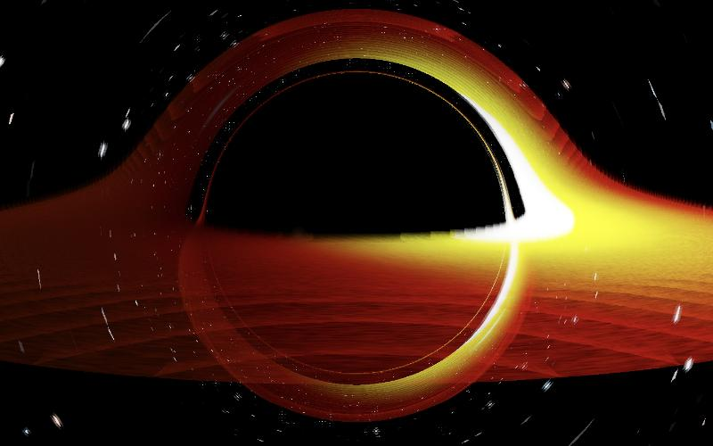

# Raymarcher

Real-time ray tracing of light around a black hole, on the GPU, with the physics checked against known results.



Every pixel traces one light ray backwards from the camera through curved spacetime. Rays that pass close to the black hole bend, loop around it, or fall in. That is what produces the dark shadow, the thin bright ring at its edge, and the image of the disk's far side wrapped over the top.

There are two renderers that share the same equations:

- **Web** (`web/`): TypeScript and WebGPU compute shaders. Runs in the browser.
- **Native** (`native/`): CUDA C++ with a GLFW/ImGui viewer, for NVIDIA GPUs.

## Status

This is the starting point of a larger project: a compiler that turns any spacetime metric into a GPU ray tracer, plus an interactive essay on how gravity bends light. Today it renders one spacetime, a non-rotating (Schwarzschild) black hole.

| Area | State |
| --- | --- |
| Schwarzschild light bending | Implemented and tested (see [Verification](#verification)) |
| Accretion disk | Artistic volumetric model, not a physical disk solution |
| Doppler and gravitational shift | Approximate: flat-space Doppler times the static redshift |
| Spinning (Kerr) black holes | Not yet. Planned through the spacetime compiler |
| Native benchmark numbers | Not published yet; run `--benchmark` on your own GPU |

## The physics

Units are geometric (G = c = 1) and M is the black hole's mass. The renderer uses isotropic coordinates, where light in Schwarzschild spacetime behaves like light in a medium with refractive index

```
n(r) = (1 + u)^3 / (1 - u),   u = M / 2r
```

With coordinate time as the parameter, so that the ray speed is |v| = 1/n, the ray equation is

```
dv/dt = ∇n / n^3  -  2 v (∇n · v) / n
```

Rays are integrated with 4th-order Runge-Kutta. The step length is fixed in space rather than in time, because light slows to 1/n near the horizon. After each step |v| is reset to exactly 1/n. A ray that is inside the photon sphere (areal radius R < 3M) and moving inward is marked as captured, because in Schwarzschild spacetime it cannot escape.

The equations live in three places that must agree:

- `web/src/shaders/raymarch.wgsl.ts` (WebGPU, f32)
- `native/src/physics.h` (CUDA kernel and CPU tests)
- `web/src/physics.ts` (double-precision reference used by the web tests)

## Verification

The test suites check the shared equations against results from the literature, not just against themselves:

| Check | Expected | Where |
| --- | --- | --- |
| Capture threshold | Rays with impact parameter b < √27 M fall in; b > √27 M escape | `physics.test.ts`, `native/tests` |
| Weak-field deflection at b = 1000 M | 4M/b + 15πM²/4b², within 0.1% | `physics.test.ts`, `native/tests` |
| Horizon and photon sphere radii | R = 2M and R = 3M under the isotropic ↔ areal conversion | both |
| ∇n | Matches a finite difference of n(r) | both |
| f32 vs f64 | The kernel's float version of the ray equation agrees with the double version | `native/tests` |
| WGSL uniform layout | TypeScript buffer offsets match the WGSL struct under WGSL alignment rules | `uniforms.test.ts` |

In the browser at default settings, the shadow's measured radius matches the predicted angular size, sin α = √27 M √(1 − 2M/R) / R, to within a few percent.

## Running it

**Web** (needs a browser with WebGPU: recent Chrome or Edge, or Safari 26+):

```bash
npm install
npm run dev
```

**Tests:**

```bash
npm test
```

```bash
cmake -S native -B native/build -DRAYMARCHER_BUILD_VIEWER=OFF && cmake --build native/build && ctest --test-dir native/build
```

**Native viewer** (needs the CUDA Toolkit 11+, CMake 3.18+ and an NVIDIA GPU):

```bash
cmake -S native -B native/build -DCMAKE_BUILD_TYPE=Release
cmake --build native/build --config Release
```

Then run `native/build/raymarcher` (`native/build/Release/raymarcher.exe` on Windows). Add `--benchmark` to time the kernel at 1080p, 1440p and 4K across several thread-block shapes. It prints frame time, rays per second and integration steps per ray, and writes `benchmark_report.json` with the GPU name and settings.

## Repository layout

```
web/       WebGPU renderer: index.html, TypeScript, WGSL shader, tests
native/    CUDA renderer: src/ (kernel, viewer, shared physics.h), tests/
docs/      Images for this README
```

## Known limitations

- The disk's density, temperature profile and edges are chosen for looks, not taken from an accretion model.
- The disk's Doppler factor uses the gas velocity in flat-space form, so brightness asymmetry is qualitative.
- Everything on the GPU is single precision.
- Only Schwarzschild spacetime is supported.
