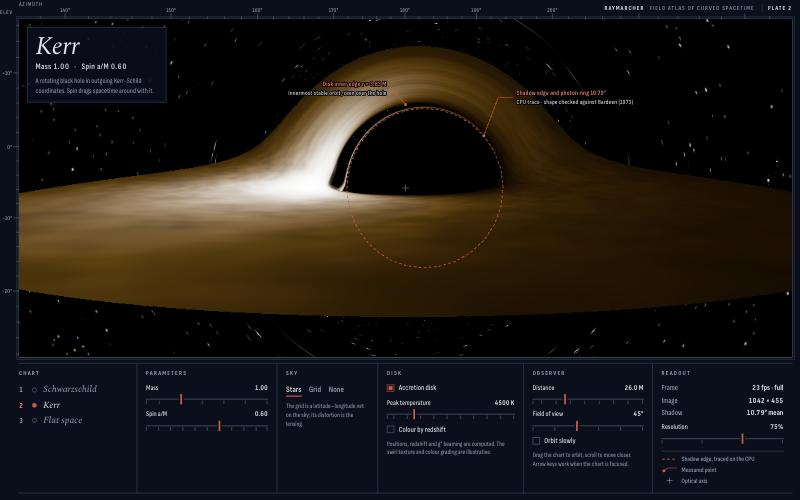
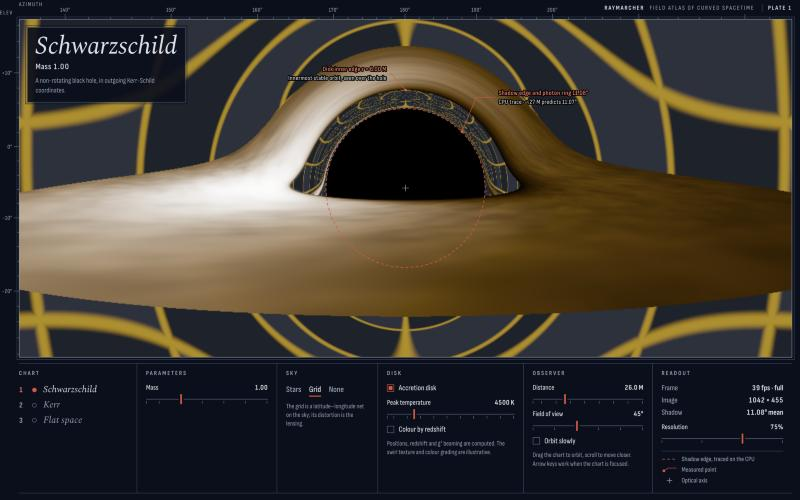

# Raymarcher

A field atlas of curved spacetime. Raymarcher compiles a spacetime's metric into a GPU ray tracer and renders what light does around it, in real time, in the browser. The physics is checked against published results.



Every pixel traces one light ray backwards from the camera through curved spacetime. Rays that pass close to a black hole bend, loop around it or fall in. That is what produces the dark shadow, the thin photon ring at its edge, and the image of the disk's far side wrapped over the top.

## How it works

You describe a spacetime in a small metric language:

```
spacetime "Schwarzschild"
coords t x y z
param M = 1 in [0.2, 3] "Mass"
let r = sqrt(x^2 + y^2 + z^2)
let f = 2*M / r
g t t = -1 + f
g t x = -f*x/r
...
horizon r < 2*M*1.01
```

The compiler (`compiler/`) does the rest:

1. **Parse** the file into an expression graph. Identical subexpressions are stored once (hash-consing), and constants fold as the graph is built.
2. **Differentiate** every metric component symbolically with respect to every coordinate.
3. **Analyse** which coordinates the metric does not depend on. Each gives a conserved momentum.
4. **Emit** straight-line code to two backends:
   - **WGSL**, for the WebGPU tracer;
   - **JavaScript** (double precision), for camera setup, the CPU cross-check and the tests.

The generated Kerr module is about 350 lines of WGSL.

Rays follow Hamilton's equations, which need only the metric g and its first derivatives. The inverse metric is computed numerically on the GPU.

```
dx^μ/dλ = g^{μν} p_ν          dp_μ/dλ = ½ (∂_μ g_{αβ}) k^α k^β,   k = g⁻¹ p
```

The camera is a static observer whose orthonormal frame is built from the local metric. Disk colours come from the exact redshift g = (p·u_camera) / (p·u_gas) for gas on circular orbits. Brightness scales as g⁴.

Built-in spacetimes (`metrics/`):
- **Schwarzschild**: a non-rotating black hole.
- **Kerr**: a spinning black hole, with spin a/M up to 0.99.
- **Flat space**: for comparison.

The black holes use outgoing Kerr-Schild coordinates. Rays traced backwards from a camera end on the past horizon, and these coordinates make that horizon regular.

## The playground

The page is laid out as one chart plate of a field star atlas:
- The render sits inside a ruled neatline. The margins carry live azimuth and elevation scales for the view.
- The key along the foot holds every control. Parameter sliders are generated from the metric file.
- The red marks are measured, not drawn. A Web Worker traces the shadow edge on the CPU, in double precision, with the same compiled metric, and draws it over the GPU image. It also locates the lensed inner edge of the disk.

For Schwarzschild the traced edge agrees with the analytic √27 M prediction to within 0.01°, which makes the overlay a live cross-check between the two backends.



## Verification

| Check | Expected | Where |
| --- | --- | --- |
| Symbolic derivatives | Match finite differences for every catalog metric | `compiler/test/compiler.test.ts` |
| Generated code | Agrees with direct evaluation of the expression graph | `compiler/test/compiler.test.ts` |
| Metric sanity | Symmetric, invertible (g g⁻¹ = I), Lorentzian | `compiler/test/compiler.test.ts` |
| Capture threshold | b < √27 M falls in, b > √27 M escapes | `compiler/test/physics.test.ts`, `native/tests` |
| Weak-field deflection | 4M/b + 15πM²/4b², within 0.1% | `compiler/test/physics.test.ts`, `native/tests` |
| Kerr shadow | Bardeen's (1973) analytic outline at a = 0.9, ±2% | `compiler/test/physics.test.ts` |
| Kerr ISCO | 6M at a = 0, 2.32M at a = 0.9 (Bardeen, Press & Teukolsky 1972) | `compiler/test/physics.test.ts` |
| Conservation | Energy and L_z conserved along rays in Kerr | `compiler/test/physics.test.ts` |
| Null constraint | H = ½ g^{μν} p_μ p_ν stays below 10⁻⁸ | `compiler/test/physics.test.ts` |
| Parser errors | Reported with line and column | `compiler/test/parser.test.ts` |
| GPU uniform layout | TypeScript offsets match the WGSL struct | `web/src/uniforms.test.ts` |

The Kerr shadow test is not trivially satisfiable: a mirrored outline (prograde and retrograde swapped) fails it.

## Running it

Needs a browser with WebGPU (recent Chrome or Edge, or Safari 26+):

```bash
npm install
npm run dev
```

```bash
npm test
```

**Native viewer** (`native/`, CUDA 11+, CMake 3.18+, an NVIDIA GPU): the CUDA renderer still uses the Phase 0 isotropic Schwarzschild kernel. It moves onto the compiler in Phase 2.

```bash
cmake -S native -B native/build -DCMAKE_BUILD_TYPE=Release
cmake --build native/build --config Release
```

Run `native/build/raymarcher` (`native/build/Release/raymarcher.exe` on Windows). Add `--benchmark` to time the kernel at 1080p, 1440p and 4K. CPU-only physics tests:

```bash
cmake -S native -B native/build-tests -DRAYMARCHER_BUILD_VIEWER=OFF && cmake --build native/build-tests && ctest --test-dir native/build-tests
```

## Repository layout

```
compiler/   metric language: parser, expression graph, derivatives, WGSL + JS backends, geodesic integrator, tests
metrics/    the spacetime catalog (.st files)
web/        WebGPU playground: tracer shader, viewer, atlas UI, CPU shadow worker
native/     CUDA renderer and its CPU physics tests
docs/       images for this README
```

## Known limitations

- **Disk:** an optically thick thin disk with a Shakura–Sunyaev-shaped temperature profile. The swirl texture and colour grading are illustrative.
- **Precision:** the GPU works in single precision. The CPU trace and the tests use double.
- **Performance:** each pixel integrates a full geodesic. Integrated laptop GPUs manage a few frames per second at full resolution, and the view drops to half resolution while you move.
- **CUDA:** the CUDA backend and the user-editable metrics are Phase 2.
